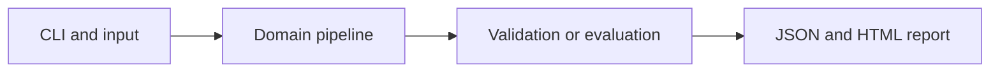

# RAG Chunking and Retrieval Benchmark

Measure how chunk size and overlap affect retrieval quality and context volume.

**Category:** RAG / Evaluation

**Execution:** Actual local algorithm or workflow; no external model service required.

## Run

```sh
python -m venv .venv
# Windows: .venv\Scripts\activate
# macOS/Linux: source .venv/bin/activate
python -m pip install -r requirements.txt
python app.py
python -m unittest discover -v
```

Open `results/report.html` after running. Python 3.10+ is required. Use `--help` for input and seed options.

## Architecture



## Algorithm

Generate fixed-word windows while retaining source identity and offsets. For each configuration rank chunks with BM25, deduplicate sources for recall, and compute reciprocal rank and returned word counts.

## Evaluation

Evaluate chunk sizes 12, 24 and 48 with zero or 25 percent overlap on the same labeled development queries. Save per-query evidence and aggregate recall@3 and MRR.

## Limitations

This is a retrieval experiment, not a claim about generated-answer quality. Configurations compared on development queries need a fresh final test set. Word windows can split sentences.

## Documentation

- [PDF project guide](PROJECT_GUIDE.pdf)
- [Editable guide](GUIDE.md)
- [Model and system card](MODEL_CARD.md)
- [Measured results](results/metrics.json)
- [Test output](TEST_RESULTS.txt)

## Extend it

Add sentence-aware chunking, token budgets, query stratification, answer support labels and independent held-out retrieval evaluation.

AI-assisted educational project with synthetic data. Review, customize and explain your own contribution accurately. MIT license.
